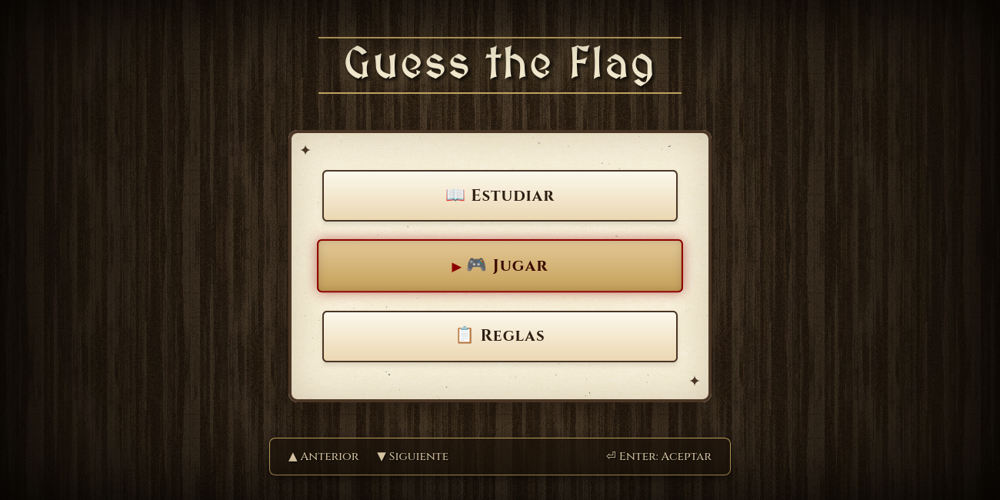

<div align="center">

# 🚩 GUESS THE FLAG

### 🌍 Aprendé geografía jugando, casi sin darte cuenta

Descubrí las banderas, los países y la población de los cinco continentes
a través de diferentes modos de juego, desafíos y actividades de estudio.

<br>


<br>



<br>

*✦ Cinco continentes, cincuenta países y muchas banderas por descubrir ✦*

</div>

---

## 📌 Sobre el proyecto

> 🌍 **Aprender geografía nunca fue tan divertido.**

**Guess the Flag** es un juego web educativo que permite aprender y reconocer las banderas de diferentes países, mientras se descubren datos geográficos y de población.

Incluye los **10 países más conocidos de cada continente**, con un total de 50 países, sus respectivas banderas y su cantidad de habitantes.

Lo que comenzó como un simple juego de adivinar banderas fue creciendo hasta convertirse en una aplicación con diferentes modalidades, un modo de estudio y una interfaz pensada para jugar tanto con **teclado en la computadora** como con **controles táctiles en celulares y tablets**.

## ✨ Características principales

| | Característica | Descripción |
|:---:|---|---|
| 🎮 | **4 modalidades** | Adivinar banderas (fácil y difícil), Higher or Lower y Estudiar. |
| 🌍 | **5 continentes + Global** | 50 países disponibles. |
| ⌨️ | **Controles por teclado** | Navegación mediante flechas, Enter y Esc. |
| 📱 | **Diseño responsive** | Adaptado a computadoras, tablets y celulares. |
| 🏳️ | **Banderas aleatorias** | No se repiten durante una misma partida. |
| 📊 | **Datos de población** | Comparación y consulta de la cantidad de habitantes de cada país. |
| 🎨 | **Diseño visual** | Estética inspirada en mapas antiguos, con una versión clara y otra oscura. |

## 🕹️ Modos de juego

Cada modalidad propone una forma diferente de aprender geografía y poner a prueba tus conocimientos.

| Modo | ¿Cómo se juega? |
|:---|:---|
| 🙂 **Adivinar banderas: Fácil** | Aparece una bandera y tenés que elegir el país correcto entre cuatro opciones. |
| 🔥 **Adivinar banderas: Difícil** | Tenés que escribir el nombre del país correspondiente a la bandera antes de que termine el tiempo. |
| 📈 **Higher or Lower** | Se muestran dos banderas y tenés que adivinar si el país de la derecha tiene más o menos habitantes que el de la izquierda. Cada acierto suma un punto. |
| 📖 **Estudiar** | Explorá las banderas de cada continente, consultá la población de los países y ordenalos según su cantidad de habitantes. |

## ⌨️ Controles

El juego permite navegar por los menús y responder preguntas utilizando el teclado, además del mouse o la pantalla táctil.

| Tecla | Acción |
|:---:|---|
| ▲ ▼ ◀ ▶ | Moverse por los menús y seleccionar opciones. |
| Enter | Confirmar una selección. |
| Esc | Volver a la pantalla anterior. |
| Q W A S | Elegir respuestas en el modo fácil (solo PC). |

## 📸 Capturas de pantalla

Un recorrido visual por las diferentes pantallas y modalidades de Guess the Flag.

### 🏠 Menú y dificultades

| Menú principal | Modo fácil | Modo difícil |
|:---:|:---:|:---:|
|  |  |  |

### 🌎 Modos de juego

| Higher or Lower | Estudiar | Versión móvil |
|:---:|:---:|:---:|
|  |  |  |

## 🛠️ Tecnologías utilizadas

El proyecto está desarrollado utilizando tecnologías web que permiten mantener una estructura sencilla, organizada y fácil de ampliar.

| Tecnología | Utilización |
|:---|:---|
| 🐍 **Python 3** | Lenguaje principal del backend. |
| ⚗️ **Flask** | Servidor web y gestión de rutas. |
| 🧩 **Jinja2** | Motor de plantillas HTML. |
| 🌐 **HTML5** | Estructura de las páginas. |
| 🎨 **CSS3** | Diseño, animaciones y adaptación responsive. |
| ⚡ **JavaScript** | Interactividad y controles del juego. |
| 📦 **JSON** | Almacenamiento de países, continentes y población. |
| 🏳️ **FlagCDN** | Fuente de las banderas en formato SVG. |

## 🚀 Instalación y ejecución

> 💻 **¿Querés probar Guess the Flag en tu computadora?**
>
> Seguí estos pasos para descargar, instalar y ejecutar el proyecto localmente.

### 📋 Requisitos previos

Antes de comenzar, necesitás tener instalados:

- Python 3.8 o superior.
- Git.
- Un navegador web actualizado.

### 1. Clonar el repositorio

Primero, abrí una terminal y ejecutá:

```bash
git clone proyecto_final
```

Ingresá a la carpeta del proyecto:

```bash
cd proyecto_final
```


### 2. crear un entorno virtual e instalar flask

## Crear un entorno virtual

1. Abrir la terminal dentro de la carpeta del proyecto.

2. Crear el entorno virtual:

```bash
python -m venv venv
```

3. Activarlo:

**Windows:**
```bash
venv\Scripts\activate
```

**Linux:**
```bash
source venv/bin/activate
```

4. Instalar las librerías necesarias:

```bash
pip install flask
```

5. Para salir del entorno virtual:

```bash
deactivate
```


### 3. Descargar las banderas

Ejecutá el siguiente script para descargar las banderas de los países:

```bash
python descargar_banderas.py
```

Las banderas se guardarán automáticamente en:

```text
static/flags/
```

Si alguna descarga falla, podés volver a ejecutar el script para intentar descargar las banderas pendientes.

### 4. Ejecutar el proyecto

Una vez instaladas las dependencias y descargadas las banderas, iniciá el servidor: 

```bash
python app.py
```

### 5. Abrir el juego

Abrí tu navegador y visitá la siguiente dirección:

```text
http://localhost:5000
```

<div align="center">

**🌍 ¡Todo listo para comenzar a jugar!**

</div>

## 📂 Estructura del proyecto

El proyecto está organizado en diferentes carpetas para separar la lógica del servidor, las páginas HTML, los estilos, los scripts y los recursos gráficos.

```text
guess-the-flag/
│
├── app.py                      # Servidor Flask: rutas y lógica del juego
├── descargar_banderas.py       # Script para descargar las banderas SVG
│
├── data/
│   └── paises.json             # Países, continentes y población
│
├── templates/                  # Páginas HTML con Jinja2
│   ├── index.html
│   ├── modo.html
│   ├── dificultad.html
│   ├── continentes.html
│   ├── continentes_dificil.html
│   ├── jugar.html
│   ├── jugar_dificil.html
│   ├── higher_lower.html
│   ├── estudiar.html
│   └── reglas.html
│
├── static/
│   ├── css/                    # Estilos de cada pantalla
│   ├── js/                     # Lógica e interactividad
│   └── flags/                  # Banderas SVG
│
├── docs/
│   └── capturas/               # Imágenes utilizadas en el README
│
└── README.md
```

### 📖 Descripción de las carpetas

| Archivo / Carpeta | Descripción |
|:---|:---|
| `app.py` | Servidor Flask, rutas y lógica del juego. |
| `descargar_banderas.py` | Script encargado de descargar las banderas SVG. |
| `data/` | Almacena los datos de los países. |
| `paises.json` | Contiene nombres, continentes, códigos y población. |
| `templates/` | Contiene las páginas HTML renderizadas mediante Jinja2. |
| `static/css/` | Hojas de estilo de cada pantalla. |
| `static/js/` | Scripts de interactividad y controles del juego. |
| `static/flags/` | Banderas de los países en formato SVG. |
| `docs/capturas/` | Imágenes utilizadas para mostrar el proyecto. |

## 🧭 Evolución del proyecto

> 📌 **El desarrollo paso a paso**
>
> Guess the Flag fue creciendo progresivamente. Cada etapa incorporó nuevas funcionalidades, mejoras visuales y cambios en la experiencia de juego.
>
> Este es el recorrido desde la primera planificación hasta la versión actual.

<details>
<summary><b>🧱 Día 1 — Planificación y organización</b></summary>

<br>

### 🎮 Diseño del sistema de controles

Planteamos la idea inicial y definimos las funcionalidades principales del juego.

- Diseñamos un joystick de cuatro botones, uno en cada esquina.
- Cada botón representa una respuesta dentro del juego.
- En los menús, los botones cambian de función para permitir navegar, seleccionar opciones, aceptar y volver.
- Organizamos la pantalla para que los controles fueran intuitivos.

### 🛠️ Primeros archivos

Creamos los primeros archivos necesarios para poner en funcionamiento el proyecto:

- `hardware.py`: lee los botones de la Raspberry Pi. Si no detecta el hardware, permite utilizar el teclado de la computadora.
- `app.py`: servidor Flask.
- `static/input.js`: recibe las entradas del teclado en el navegador. Utilizamos las teclas Q, W, A y S para realizar las pruebas.
- `templates/base.html` e `index.html`: estructura base y menú principal.
- `static/style.css`: primeros estilos visuales.

### 🌍 Datos y banderas

- Aprendimos a trabajar con archivos JSON.
- Creamos `paises.json` con 50 países, 10 por continente.
- Seleccionamos los países que formarían parte del juego.
- Desarrollamos `descargar_banderas.py` para descargar las 50 banderas en formato SVG dentro de `static/flags/`.

</details>

<details>
<summary><b>🙂 Día 2 — Desarrollo de las primeras modalidades</b></summary>

<br>

### 🎮 Modo de juego

Comenzamos a desarrollar la modalidad principal de adivinar banderas.

- Creamos una pantalla para seleccionar el continente (`continentes.html`).
- Desarrollamos una pantalla de juego reutilizable (`jugar.html`).
- Incorporamos la bandera, cuatro respuestas posibles, un contador de puntos y un reloj de 60 segundos.
- Agregamos las rutas correspondientes en `app.py`.

### 📖 Modo de estudio

También comenzamos a desarrollar las pantallas destinadas al aprendizaje de las banderas y los países.

### 🛠️ Organización

Creamos nuevos archivos HTML y CSS para separar las diferentes pantallas y mantener el proyecto organizado.

</details>

<details>
<summary><b>🔥 Día 3 — Nuevas dificultades y cambios en los controles</b></summary>

<br>

### 🎯 Adaptación de los controles

Durante el desarrollo surgieron dificultades para utilizar la Raspberry Pi, por lo que tuvimos que adaptar el proyecto para manejarlo mediante el teclado de la computadora.

### 🔥 Incorporación del modo difícil

- Agregamos una pantalla de selección de dificultad.
- En el modo fácil se mantienen las cuatro respuestas posibles.
- En el modo difícil hay que escribir el nombre del país correspondiente a la bandera.
- Las respuestas se comparan sin distinguir mayúsculas, minúsculas ni tildes, para evitar errores de formato.

### ⏱️ Incorporación del reloj

Establecimos diferentes tiempos según el tipo de partida:

- 40 segundos por continente.
- 100 segundos en el modo Global.

### 🎨 Cambios visuales

Al seleccionar la dificultad, también cambia el diseño de la interfaz:

- Modo fácil: apariencia clara.
- Modo difícil: apariencia oscura.

</details>

<details>
<summary><b>🧭 Día 4 — Diseño de la interfaz y nuevas modalidades</b></summary>

<br>

### 🎨 Diseño visual

- Desarrollamos la mayoría de las hojas de estilo de las diferentes pantallas.
- Unificamos la estética inspirada en mapas antiguos.
- Mejoramos la presentación de los menús, las tarjetas y las dificultades.

### 📈 Nuevo modo: Higher or Lower

Incorporamos una nueva modalidad basada en la comparación de población entre países.

- Se muestran dos banderas.
- El jugador debe decidir si el país de la derecha tiene más o menos habitantes que el de la izquierda.
- Cada respuesta correcta suma un punto.

### 🌍 Nuevos datos

Incorporamos la población de cada país al archivo de datos para poder utilizarla en esta nueva modalidad.

</details>

<details>
<summary><b>🏆 Etapa 5 — Optimización y mejoras finales</b></summary>

<br>

### 📱 Adaptación a dispositivos

- Terminamos de ajustar los estilos para diferentes tamaños de pantalla.
- Mejoramos la visualización en celulares y tablets.
- Corregimos problemas de distribución y superposición de elementos.

### 📖 Mejoras en el modo de estudio

- Incorporamos información de población.
- Mejoramos la interacción con las tarjetas de países.
- Modificamos su funcionamiento para facilitar el aprendizaje.

### 🥇 Sistema de ranking

Agregamos un sistema para guardar los tres primeros puestos del modo Higher or Lower.

### 📜 Actualización de las reglas

Incorporamos las instrucciones correspondientes a las nuevas modalidades de juego.

</details>

<details>
<summary><b>📖 Etapa 6 — Estudio de países y población</b></summary>

<br>

### 🏳️ Información de cada país

- Al tocar una tarjeta aparece la cantidad de habitantes, sin que desaparezca la bandera.
- Mejoramos la presentación de los datos para facilitar su consulta.

### 📊 Ordenamiento por población

- Incorporamos la opción de ordenar los 50 países de mayor a menor población.
- Cada país muestra su posición en el ranking.
- La opción también puede seleccionarse mediante las flechas del teclado y Enter.

</details>

## 🗺️ Roadmap — Próximas mejoras

Estas son algunas de las funcionalidades que ya se completaron y otras que nos gustaría incorporar en futuras versiones.

| Estado | Funcionalidad |
|:---:|:---|
| ✅ | Menú principal, modo fácil y modo difícil. |
| ✅ | Modo Higher or Lower. |
| ✅ | Modo Estudiar con población y ranking. |
| ✅ | Diseño responsive para celulares y tablets. |
| 🔲 | Incorporar más países por continente. |
| 🔲 | Guardar los récords de forma permanente. |
| 🔲 | Incorporar un modo multijugador. |
| 🔲 | Traducir el juego a otros idiomas. |

## 🤝 Contribuciones

Las contribuciones son bienvenidas.

Si encontrás algún error, tenés una sugerencia o querés proponer una nueva funcionalidad, podés colaborar mediante:

- **Issues:** para informar errores o proponer mejoras.
- **Pull Requests:** para enviar cambios y nuevas funcionalidades.

¡Toda contribución ayuda a que el proyecto siga creciendo!

## 👨‍💻 Autor

Desarrollado por **TU NOMBRE**.

- GitHub: [@TU_USUARIO](https://github.com/TU_USUARIO)
- LinkedIn: [Mi perfil](https://www.linkedin.com/in/TU_PERFIL/)

## 📄 Licencia

Este proyecto está distribuido bajo la licencia MIT.

Podés consultar las condiciones de uso en el archivo [LICENSE](./LICENSE).

---

<div align="center">

### 🌍 GUESS THE FLAG 🚩

**Hecho con ❤️, código y muchas banderas.**

*Gracias por visitar nuestro proyecto.*

</div>
